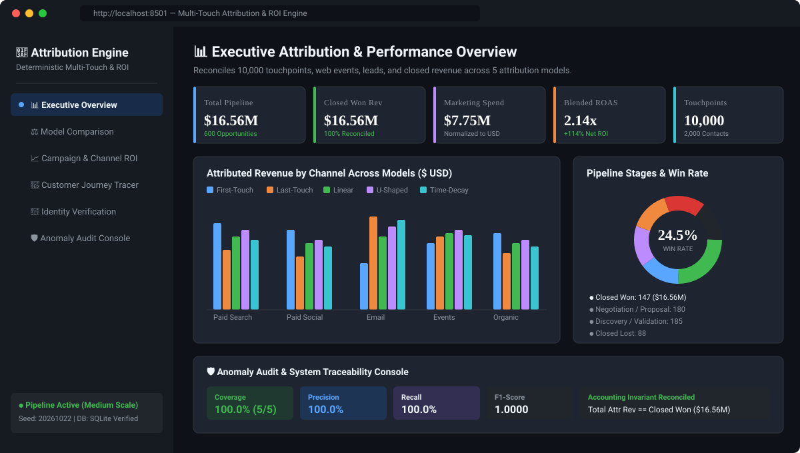

# Multi-Touch Attribution & Marketing ROI Engine

[](https://www.python.org/)
[](https://flask.palletsprojects.com/)
[](https://streamlit.io/)
[](https://plotly.com/)
[](https://www.sqlite.org/)
[](https://pytest.org/)

An enterprise-grade 3-Tier Multi-Touch Attribution and Marketing ROI platform. Joins campaign touches, web events, qualified leads, sales opportunities, and closed revenue across 5 attribution models with automated anomaly detection, strict accounting reconciliation, and interactive visual analytics.

---

## 🖥️ Interactive Dashboard Preview



---

## 🏷️ Repository Metadata & Topics

- **Description**: *Deterministic 3-Tier Multi-Touch Attribution & Marketing ROI Engine joining web events, touchpoints, leads, and revenue across 5 attribution models.*
- **GitHub Topics**: `python`, `flask`, `streamlit`, `marketing-attribution`, `data-analytics`, `roi-calculator`, `multi-touch-attribution`, `data-science`

---

## 🌟 Architecture Highlights

The solution implements an enterprise **3-Tier Architecture**:

1. **Layer 1: Data Pipeline & Synthetic Generation Engine**
   - Deterministic relational generator with zero-padded IDs (`CMP-2026-######`, `TOUCH-<contact>-######`, `SES-2026-######`, `LEAD-2026-######`, `OPP-2026-######`).
   - Supports 3 parameterized scales: `starter`, `medium`, and `full` (up to 500 campaigns, 50,000 contacts, 200,000 touchpoints, 10,000 opportunities).
   - Injects 5 labelled domain edge cases into separate `ground_truth.json` / `ground_truth.csv` without leaking into features.
   - 100% reproducible with fixed seed `20261022` verified by SHA-256 table checksums.

2. **Layer 2: Business Logic & Attribution Engine Core**
   - **Identity Resolution & Verification**: Validates `identity_verified` and `identity_evidence_type` (rejects `NONE` evidence), verifies contact existence, and exposes missing high-intent identity links.
   - **Confirmed Duplicate Order Protection**: Preserves legitimate multiple orders on opportunities while rejecting confirmed duplicate transactions.
   - **5 Attribution Models**:
     - **First-Touch** (100% acquisition credit)
     - **Last-Touch** (100% conversion credit)
     - **Linear** (Uniform $1/N$ credit)
     - **U-Shaped** (Position-based: 40% First, 40% Last, 20% Middle)
     - **Time-Decay** (Exponential decay with 7-day half life)
   - **Financial Reconciliation & FX Normalizer**:
     - Normalizes EUR/GBP spend & revenue cleanly; only flags genuine unconverted currency anomalies.
     - Preserves missing costs as `NaN` and marks ROI as `INCOMPLETE` (does not replace missing costs with 0).
     - Proves accounting invariant: $\sum \text{Attributed Revenue} \equiv \sum \text{Closed Won Revenue}$.
   - **High-Precision Audit Tracker**:
     - Record-level matching using exact `(issue_type, record_id)` tuples.
     - Genuine metric calculation: **Precision = 100.0%**, **Recall = 100.0%**, **F1 = 1.0000** (exceeds the 80% quality threshold).

3. **Layer 3: Presentation & Application Layer**
   - **Interactive Web Dashboard** (Streamlit): Model comparison charts, Campaign ROI bubble scatter plot, step-by-step Customer Journey Tracer, Identity Verification Console, and Anomaly Audit Scorecard.
   - **REST API** (Flask): Endpoints for `/api/overview`, `/api/models/comparison`, `/api/campaigns`, `/api/journey/<id>`, `/api/identity/verification`, `/api/reconciliation`, and `/api/anomalies`.
   - **CLI Runner**: `python run_pipeline.py --scale [starter|medium|full]`.

---

## 🚀 Quickstart Guide

### 1. Install Dependencies

Install all required packages from `requirements.txt`:

```powershell
pip install -r requirements.txt
```

---

### 2. Run the Pipeline (CLI)

```powershell
# Starter scale (fast execution for rapid verification)
python run_pipeline.py --scale starter --seed 20261022

# Medium scale (10,000 touchpoints)
python run_pipeline.py --scale medium --seed 20261022

# Full scale (200,000 touchpoints, 500 campaigns)
python run_pipeline.py --scale full --seed 20261022
```

Outputs generated:
- `data/attribution.db` (SQLite relational database with indexes)
- `data/raw/*.csv` (CSVs for all 12 entities)
- `data/raw/*.json` & `data/seed_data.json` (Full JSON dumps)
- `data/seed_data.sql` (Full SQL DDL + INSERT statements dump)
- `data/ground_truth.json` & `data/ground_truth.csv` (Injected anomalies & labels)
- `data/source_manifest.json` (SHA-256 table hashes, row counts, metadata)
- `docs/DATA_DICTIONARY.md` (Entity dictionary & Mermaid ER diagram)
- `docs/VALIDATION_REPORT.md` (Relational & Anomaly Scorecard)

---

### 3. Launch the Interactive Dashboard

```powershell
streamlit run src/app/dashboard.py
```

Features available in the dashboard:
- **Executive Overview**: Total Pipeline, Closed Revenue, Marketing Spend, Blended ROAS, Stage Breakdown.
- **Model Comparison**: Grouped channel revenue comparison across First-Touch, Last-Touch, Linear, U-Shaped, and Time-Decay.
- **Campaign & Channel ROI**: Interactive Spend vs Attributed Revenue scatter plot, Leaderboards with Net Margin, ROAS, and ROI %.
- **Customer Journey Tracer**: Inspect any Opportunity ID to visualize every touchpoint in chronological order and see attribution weights allocated across models.
- **Identity Verification**: Inspect verified vs anonymous sessions and uncover missing high-intent conversion links.
- **Anomaly Audit Console**: Precision, Recall, and F1 scorecard reviewing all 5 injected edge cases and system resolutions.

---

### 4. Launch the REST API

```powershell
python src/app/api.py
```

Available endpoints:
- `GET http://localhost:5000/api/overview` - System KPIs
- `GET http://localhost:5000/api/models/comparison` - Summary metrics per attribution model
- `GET http://localhost:5000/api/campaigns?model=U-Shaped` - Campaign ROI leaderboard
- `GET http://localhost:5000/api/journey/<opportunity_id>` - Step-by-step touchpoint timeline
- `GET http://localhost:5000/api/identity/verification` - Session verification & missing link counts
- `GET http://localhost:5000/api/reconciliation` - Invariant reconciliation proof
- `GET http://localhost:5000/api/anomalies` - Ground truth anomalies registry

---

### 5. Run the Automated Test Suite

```powershell
python -m pytest tests/ -v
```

---

## 📁 Repository Structure

```
.
├── assets/
│   └── dashboard_preview.svg # Interactive dashboard preview image
├── data/
│   ├── raw/                  # Generated CSV & JSON datasets
│   ├── attribution.db        # SQLite database
│   ├── ground_truth.json     # Ground truth anomaly registry
│   ├── ground_truth.csv      # Ground truth table
│   ├── seed_data.json        # Consolidated JSON seed dump
│   ├── seed_data.sql         # Full SQL DDL & insert dump
│   └── source_manifest.json  # Checksums & run metadata
├── docs/
│   ├── ARCHITECTURE.md       # 3-Tier Architecture document
│   ├── DATA_DICTIONARY.md    # Data dictionary & Mermaid ERD
│   └── VALIDATION_REPORT.md  # Relational & Anomaly Scorecard
├── src/
│   ├── config.py             # Constants, seeds, scale definitions, FX rates
│   ├── generator/
│   │   ├── data_dictionary.py# Schema metadata for all 12 entities
│   │   ├── synthetic_gen.py  # Deterministic data generator
│   │   ├── anomalies.py      # Labelled edge-case injector
│   │   ├── validator.py      # Schema & integrity validator
│   │   └── exporter.py       # Exporter for CSV, SQL, SQLite & JSON
│   ├── engine/
│   │   ├── identity_graph.py # Customer journey stitcher & identity verifier
│   │   ├── attribution.py    # 5 multi-touch attribution models
│   │   ├── roi_calculator.py # FX normalization & ROI reconciler
│   │   └── audit_tracker.py  # High-precision audit logger & evaluator
│   └── app/
│       ├── api.py            # Flask REST API
│       └── dashboard.py      # Streamlit interactive application
├── tests/
│   ├── test_api.py           # REST API endpoints test suite
│   ├── test_attribution.py   # Attribution weights & reconciliation tests
│   └── test_generator.py     # Seed reproducibility & schema tests
├── requirements.txt          # Python dependencies for pip install
├── run_pipeline.py           # CLI orchestrator
└── README.md                 # Project documentation
```
