# 3-Tier Multi-Touch Attribution & ROI Engine: Architecture Document

## System Architecture Overview

The system is engineered as an enterprise-grade 3-Tier Multi-Touch Attribution & Marketing ROI Engine designed to ingest, stitch, attribute, and evaluate marketing campaign touchpoints, anonymous and identified web sessions, leads, opportunities, and closed revenue.

```mermaid
flowchart TD
    subgraph Layer1["Layer 1: Data Pipeline & Synthetic Engine"]
        MasterGen["Master Entity Generator\n(Channels, Audiences, Campaigns, Creatives, Contacts)"]
        EventGen["Event & Session Generator\n(WebSessions, Touchpoints, Conversion Windows)"]
        TransGen["Transaction & Pipeline Generator\n(Leads, Opportunities, Orders, CostRecords)"]
        AnomalyInj["Labelled Anomaly Injector\n(5 Injected Domain Edge Cases)"]
        GTRegistry["Ground Truth Registry\n(ground_truth.json / .csv)"]
        Validator["Relational Schema & PK/FK Validator"]
        DBExport["Storage & Seed Exporter\n(SQLite attribution.db, raw CSVs, SQL seed)"]
        
        MasterGen --> EventGen --> TransGen --> AnomalyInj
        AnomalyInj --> GTRegistry
        AnomalyInj --> Validator --> DBExport
    end

    subgraph Layer2["Layer 2: Business Logic & Attribution Engine Core"]
        Identity["Identity Graph & Journey Stitcher\n(Temporal Window Filtering, Session Binding)"]
        AttrEngine["Multi-Model Attribution Engine\n(First, Last, Linear, U-Shaped, Time-Decay)"]
        ROIEngine["Financial Reconciliation & FX Normalizer\n(USD conversion, Spend Reconciler, ROI / ROAS)"]
        AuditTrack["Audit Trail & Traceability Tracker\n(Exception Handling & Ground Truth Evaluation)"]
        
        DBExport --> Identity --> AttrEngine
        DBExport --> ROIEngine
        AttrEngine --> ROIEngine
        Identity --> AuditTrack
        AttrEngine --> AuditTrack
        ROIEngine --> AuditTrack
    end

    subgraph Layer3["Layer 3: Presentation & Application Layer"]
        CLI["Pipeline Runner CLI\n(run_pipeline.py --scale starter|medium|full)"]
        RestAPI["Flask REST API\n(src/app/api.py - /api/models, /api/campaigns)"]
        Dashboard["Streamlit Interactive Dashboard\n(src/app/dashboard.py)"]
        
        AttrEngine --> RestAPI
        ROIEngine --> Dashboard
        AuditTrack --> Dashboard
        CLI --> Layer1
        CLI --> Layer2
    end
```

---

## Detailed Layer Breakdown

### Layer 1: Data Pipeline & Synthetic Engine
- **Deterministic Master & Event Generation**:
  - Implements zero-padded deterministic IDs: `CMP-2026-######`, `TOUCH-<contact-id>-######`, `SES-2026-######`, `LEAD-2026-######`, `OPP-2026-######`.
  - Configurable seed (default: `20261022`) guaranteeing bit-for-bit reproducibility verified by SHA-256 table checksums.
  - Parameterized scales: `starter` (30 campaigns, 150 contacts, 800 touches), `medium` (100 campaigns, 2,000 contacts, 10,000 touches), and `full` (500 campaigns, 50,000 contacts, 200,000 touches).
- **Labelled Edge Cases Injection**:
  1. *Revenue counted more than once* (Duplicate order creation).
  2. *Touchpoint after conversion attributed* (Post-deal-close touchpoint timestamps).
  3. *Spend currency mismatch* (Foreign EUR/GBP spend records).
  4. *Campaign costs omitted* (Active revenue-generating campaigns missing spend records).
  5. *Anonymous session linked without evidence* (Phantom contact stitching).
- **Separate Ground Truth**: Isolated in `ground_truth.json` / `ground_truth.csv` without leaking into input features.

### Layer 2: Business Logic & Attribution Engine Core
- **Identity Graph & Journey Stitcher**: Reconstructs unified chronological touchpoint sequence per contact and opportunity, enforcing temporal conversion windows ($t_{\text{touch}} \le t_{\text{closed}}$).
- **5 Multi-Touch Attribution Models**:
  - **First-Touch**: 100% credit to the discovery touchpoint.
  - **Last-Touch**: 100% credit to the last touchpoint prior to opportunity conversion.
  - **Linear**: Equal weight shared uniformly ($1/N$).
  - **U-Shaped (Position-Based)**: 40% First touch, 40% Last touch, 20% divided evenly among middle touches.
  - **Time-Decay**: Exponential half-life decay ($w_i = 2^{-(t_{\text{close}} - t_i) / \text{half\_life}}$) prioritizing interactions closer to the deal closing.
  - Strict mathematical invariant: $\sum w_i = 1.0$ for all models.
- **Financial Reconciliation & FX Normalizer**:
  - Converts EUR and GBP costs to USD using official currency rates.
  - $\text{Net Margin} = \text{Attributed Revenue} - \text{Spend}$
  - $\text{ROAS} = \frac{\text{Attributed Revenue}}{\text{Spend}}$
  - $\text{ROI \%} = \frac{\text{Attributed Revenue} - \text{Spend}}{\text{Spend}} \times 100$
- **Audit & Exception Tracker**: Evaluates anomaly handling against Ground Truth.

### Layer 3: Presentation & Application Layer
- **Interactive Streamlit Web Dashboard** (`src/app/dashboard.py`):
  - Executive Overview KPI metrics and stage breakdowns.
  - Side-by-side attribution model comparison by channel.
  - Campaign ROI bubble scatter plot and performance leaderboards.
  - Step-by-step customer journey tracer.
  - Anomaly audit console.
- **REST API** (`src/app/api.py`): Clean JSON endpoints for downstream BI integrations.
- **CLI Runner** (`run_pipeline.py`): Parameterized CLI orchestrating the end-to-end flow.
