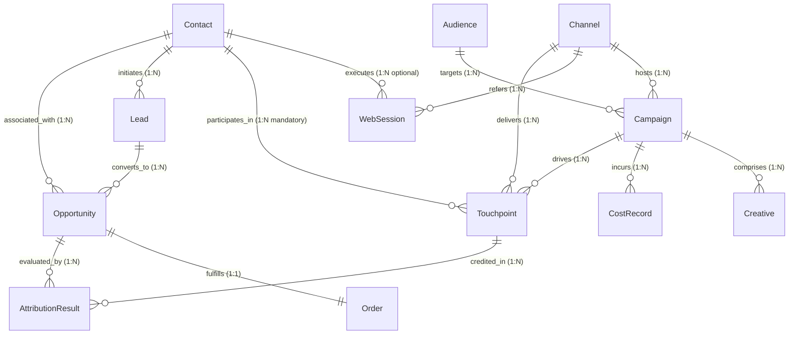

# Multi-Touch Attribution Engine: Comprehensive Data Dictionary & Relational Schema

## Entity Relationship Diagram (ERD) with Cardinality

## Lifecycle States & Allowed Transitions

- **Contact**: `Visitor` -> `Lead` -> `MQL` -> `SQL` -> `Opportunity` -> `Customer` (or `Churned`)
- **Opportunity**: `Discovery` -> `Validation` -> `Proposal` -> `Negotiation` -> `Closed Won` / `Closed Lost`
- **Lead**: `Open` -> `Contacted` -> `Qualified` -> `Converted` / `Unqualified`

### Entity: `Channel`
*Marketing distribution channel definition*
- **Primary Key**: `channel_id`
- **Cardinality**:
  - `Campaign`: 1:N (One channel hosts multiple campaigns)
  - `WebSession`: 1:N (One channel refers multiple web sessions)
  - `Touchpoint`: 1:N (One channel delivers multiple touchpoints)
- **Lifecycle States**: Active, Archived

| Field Name | Type | Required | Unique | Validation / Allowed Values / Units |
|---|---|---|---|---|
| `channel_id` | string | Yes | Yes | Pattern: `CHN-###` |
| `channel_name` | string | Yes | No | Enum: Paid Search, Paid Social, Organic Search, Email, Display, Events/Conferences, Direct, Referral |
| `channel_type` | string | Yes | No | Enum: Inbound, Outbound, Organic, Paid |
| `is_paid` | boolean | Yes | No |  |
| `created_at` | datetime | Yes | No |  |

### Entity: `Audience`
*Target audience segment definition*
- **Primary Key**: `audience_id`
- **Cardinality**:
  - `Campaign`: 1:N (One audience segment targeted by multiple campaigns)
- **Lifecycle States**: Active, Inactive

| Field Name | Type | Required | Unique | Validation / Allowed Values / Units |
|---|---|---|---|---|
| `audience_id` | string | Yes | Yes | Pattern: `AUD-2026-######` |
| `audience_name` | string | Yes | No |  |
| `industry` | string | Yes | No | Enum: Technology, Healthcare, Financial Services, Manufacturing, Retail, Education |
| `tier` | string | Yes | No | Enum: Enterprise, Mid-Market, SMB |
| `target_persona` | string | Yes | No | Enum: CTO/VP Eng, CMO/VP Mktg, CFO/Finance, Operations Lead, Security Lead |
| `created_at` | datetime | Yes | No |  |

### Entity: `Campaign`
*Marketing campaign master record with budget, channel, and timeframe*
- **Primary Key**: `campaign_id`
- **Foreign Keys**:
  - `channel_id` -> `Channel.channel_id (Required)`
  - `audience_id` -> `Audience.audience_id (Required)`
- **Cardinality**:
  - `Channel`: N:1 (Belongs to one channel)
  - `Audience`: N:1 (Targets one audience)
  - `Creative`: 1:N (Comprises multiple creatives)
  - `Touchpoint`: 1:N (Drives multiple touchpoints)
  - `CostRecord`: 1:N (Incurs multiple cost line items)
- **Lifecycle States**: Active, Completed, Paused
- **Effective Dates**: start_date to end_date (end_date >= start_date)

| Field Name | Type | Required | Unique | Validation / Allowed Values / Units |
|---|---|---|---|---|
| `campaign_id` | string | Yes | Yes | Pattern: `CMP-2026-######` |
| `campaign_name` | string | Yes | No |  |
| `channel_id` | string | Yes | No |  |
| `audience_id` | string | Yes | No |  |
| `budget` | float | Yes | No | Range: [500.0, inf] (Unit: currency) |
| `currency` | string | Yes | No | Enum: USD, EUR, GBP |
| `status` | string | Yes | No | Enum: Active, Completed, Paused |
| `start_date` | date | Yes | No |  |
| `end_date` | date | Yes | No | end_date >= start_date |

### Entity: `Creative`
*Advertising creative or content asset tied to a campaign*
- **Primary Key**: `creative_id`
- **Foreign Keys**:
  - `campaign_id` -> `Campaign.campaign_id (Required)`
- **Cardinality**:
  - `Campaign`: N:1 (Belongs to one campaign)
  - `Touchpoint`: 1:N (Associated with multiple touchpoints, optional)
- **Lifecycle States**: Draft, Live, Retired

| Field Name | Type | Required | Unique | Validation / Allowed Values / Units |
|---|---|---|---|---|
| `creative_id` | string | Yes | Yes | Pattern: `CRT-2026-######` |
| `campaign_id` | string | Yes | No |  |
| `asset_type` | string | Yes | No | Enum: Video, Static Banner, Whitepaper, Webinar, Text Ad, Case Study |
| `headline` | string | Yes | No |  |
| `call_to_action` | string | Yes | No | Enum: Book Demo, Download Now, Start Free Trial, Contact Sales, Learn More |
| `created_at` | datetime | Yes | No |  |

### Entity: `Contact`
*Prospective or existing customer master record*
- **Primary Key**: `contact_id`
- **Cardinality**:
  - `WebSession`: 1:N (Executes multiple web sessions, optional)
  - `Touchpoint`: 1:N (Participates in multiple touchpoints, mandatory)
  - `Lead`: 1:N (Initiates leads)
  - `Opportunity`: 1:N (Associated with multiple opportunities)
  - `Order`: 1:N (Places multiple revenue orders)
- **Lifecycle States**: Visitor, Lead, MQL, SQL, Opportunity, Customer, Churned

| Field Name | Type | Required | Unique | Validation / Allowed Values / Units |
|---|---|---|---|---|
| `contact_id` | string | Yes | Yes | Pattern: `CNT-2026-######` |
| `email` | string | Yes | Yes |  |
| `first_name` | string | Yes | No |  |
| `last_name` | string | Yes | No |  |
| `company_name` | string | Yes | No |  |
| `job_role` | string | Yes | No |  |
| `lifecycle_stage` | string | Yes | No | Enum: Visitor, Lead, MQL, SQL, Opportunity, Customer, Churned |
| `created_at` | datetime | Yes | No |  |

### Entity: `WebSession`
*Web traffic session event, either anonymous or linked to contact*
- **Primary Key**: `session_id`
- **Foreign Keys**:
  - `contact_id` -> `Contact.contact_id (Optional/Nullable)`
  - `channel_id` -> `Channel.channel_id (Required)`
- **Cardinality**:
  - `Contact`: N:1 (Optionally resolved to one contact via cookie)
  - `Channel`: N:1 (Originated from one channel)
  - `Touchpoint`: 1:1 (May generate a digital touchpoint)

| Field Name | Type | Required | Unique | Validation / Allowed Values / Units |
|---|---|---|---|---|
| `session_id` | string | Yes | Yes | Pattern: `SES-2026-######` |
| `cookie_id` | string | Yes | No |  |
| `contact_id` | string | No | No |  |
| `channel_id` | string | Yes | No |  |
| `landing_page` | string | Yes | No |  |
| `page_views` | integer | Yes | No | Range: [1, inf] |
| `duration_seconds` | integer | Yes | No | Range: [0, inf] |
| `device_type` | string | Yes | No | Enum: Desktop, Mobile, Tablet |
| `started_at` | datetime | Yes | No |  |
| `ended_at` | datetime | Yes | No | ended_at >= started_at |

### Entity: `Touchpoint`
*Marketing interaction event across digital or offline touchpoints*
- **Primary Key**: `touchpoint_id`
- **Foreign Keys**:
  - `contact_id` -> `Contact.contact_id (Required)`
  - `campaign_id` -> `Campaign.campaign_id (Required)`
  - `channel_id` -> `Channel.channel_id (Required)`
  - `creative_id` -> `Creative.creative_id (Optional)`
  - `session_id` -> `WebSession.session_id (Optional)`
- **Cardinality**:
  - `Contact`: N:1 (Belongs to one contact)
  - `Campaign`: N:1 (Belongs to one campaign)
  - `Channel`: N:1 (Belongs to one channel)
  - `AttributionResult`: 1:N (Attributed across 5 models)

| Field Name | Type | Required | Unique | Validation / Allowed Values / Units |
|---|---|---|---|---|
| `touchpoint_id` | string | Yes | Yes | Pattern: `TOUCH-<contact-id>-######` |
| `contact_id` | string | Yes | No |  |
| `campaign_id` | string | Yes | No |  |
| `channel_id` | string | Yes | No |  |
| `creative_id` | string | No | No |  |
| `session_id` | string | No | No |  |
| `interaction_type` | string | Yes | No | Enum: Ad Click, Email Open, Email Click, Content Download, Webinar Attended, Conference Meeting, Product Demo, Direct Visit |
| `medium` | string | Yes | No | Enum: Online, Offline |
| `touchpoint_cost` | float | Yes | No | Range: [0.0, inf] |
| `timestamp` | datetime | Yes | No |  |

### Entity: `Lead`
*Captured qualified marketing lead associated with a contact*
- **Primary Key**: `lead_id`
- **Foreign Keys**:
  - `contact_id` -> `Contact.contact_id (Required)`
  - `first_touchpoint_id` -> `Touchpoint.touchpoint_id (Required)`
  - `session_id` -> `WebSession.session_id (Optional)`
- **Cardinality**:
  - `Contact`: N:1 (Belongs to one contact)
  - `Opportunity`: 1:1 or 1:N (Converts to opportunities)
- **Lifecycle States**: Open, Contacted, Qualified, Unqualified, Converted

| Field Name | Type | Required | Unique | Validation / Allowed Values / Units |
|---|---|---|---|---|
| `lead_id` | string | Yes | Yes | Pattern: `LEAD-2026-######` |
| `contact_id` | string | Yes | No |  |
| `first_touchpoint_id` | string | Yes | No |  |
| `session_id` | string | No | No |  |
| `lead_score` | integer | Yes | No | Range: [0, 100] |
| `status` | string | Yes | No | Enum: Open, Contacted, Qualified, Unqualified, Converted |
| `created_at` | datetime | Yes | No |  |

### Entity: `Opportunity`
*Sales pipeline deal progressing through stages to Won/Lost*
- **Primary Key**: `opportunity_id`
- **Foreign Keys**:
  - `contact_id` -> `Contact.contact_id (Required)`
  - `lead_id` -> `Lead.lead_id (Required)`
- **Cardinality**:
  - `Contact`: N:1 (Belongs to one contact)
  - `Lead`: N:1 (Converted from one lead)
  - `Order`: 1:1 (Closed Won deal creates exactly one order)
  - `AttributionResult`: 1:N (Attributed across 5 models)
- **Lifecycle States**: Discovery, Validation, Proposal, Negotiation, Closed Won, Closed Lost

| Field Name | Type | Required | Unique | Validation / Allowed Values / Units |
|---|---|---|---|---|
| `opportunity_id` | string | Yes | Yes | Pattern: `OPP-2026-######` |
| `contact_id` | string | Yes | No |  |
| `lead_id` | string | Yes | No |  |
| `opportunity_name` | string | Yes | No |  |
| `stage` | string | Yes | No | Enum: Discovery, Validation, Proposal, Negotiation, Closed Won, Closed Lost |
| `amount` | float | Yes | No | Range: [0.0, inf] |
| `currency` | string | Yes | No | Enum: USD, EUR, GBP |
| `created_at` | datetime | Yes | No |  |
| `closed_at` | datetime | No | No | closed_at >= created_at |

### Entity: `Order`
*Closed revenue transaction linked to closed-won opportunity*
- **Primary Key**: `order_id`
- **Foreign Keys**:
  - `opportunity_id` -> `Opportunity.opportunity_id (Required, 1:1)`
  - `contact_id` -> `Contact.contact_id (Required)`
- **Cardinality**:
  - `Opportunity`: 1:1 (Unique order per closed-won opportunity)
  - `Contact`: N:1 (Belongs to one customer contact)
- **Lifecycle States**: Completed, Refunded, Processing

| Field Name | Type | Required | Unique | Validation / Allowed Values / Units |
|---|---|---|---|---|
| `order_id` | string | Yes | Yes | Pattern: `ORD-2026-######` |
| `opportunity_id` | string | Yes | No |  |
| `contact_id` | string | Yes | No |  |
| `order_date` | datetime | Yes | No |  |
| `gross_revenue` | float | Yes | No | Range: [0.0, inf] |
| `currency` | string | Yes | No | Enum: USD, EUR, GBP |
| `status` | string | Yes | No | Enum: Completed, Refunded, Processing |

### Entity: `CostRecord`
*Direct financial spend record attributed to marketing campaigns*
- **Primary Key**: `cost_record_id`
- **Foreign Keys**:
  - `campaign_id` -> `Campaign.campaign_id (Required)`
  - `channel_id` -> `Channel.channel_id (Required)`
- **Cardinality**:
  - `Campaign`: N:1 (Belongs to one campaign)
  - `Channel`: N:1 (Belongs to one channel)

| Field Name | Type | Required | Unique | Validation / Allowed Values / Units |
|---|---|---|---|---|
| `cost_record_id` | string | Yes | Yes | Pattern: `CST-2026-######` |
| `campaign_id` | string | Yes | No |  |
| `channel_id` | string | Yes | No |  |
| `spend_date` | date | Yes | No |  |
| `spend_amount` | float | Yes | No | Range: [0.0, inf] |
| `currency` | string | Yes | No | Enum: USD, EUR, GBP |
| `cost_category` | string | Yes | No | Enum: Media Spend, Agency Fee, Software Tool, Sponsorship, Production |

### Entity: `AttributionResult`
*Calculated attribution weight, revenue, and ROI per touchpoint and model*
- **Primary Key**: `attribution_id`
- **Foreign Keys**:
  - `opportunity_id` -> `Opportunity.opportunity_id (Required)`
  - `touchpoint_id` -> `Touchpoint.touchpoint_id (Required)`
  - `campaign_id` -> `Campaign.campaign_id (Required)`
  - `channel_id` -> `Channel.channel_id (Required)`
- **Cardinality**:
  - `Opportunity`: N:1 (Belongs to one opportunity)
  - `Touchpoint`: N:1 (Attributed to one touchpoint)
  - `Campaign`: N:1 (Credited to one campaign)

| Field Name | Type | Required | Unique | Validation / Allowed Values / Units |
|---|---|---|---|---|
| `attribution_id` | string | Yes | Yes | Pattern: `ATTR-2026-######` |
| `opportunity_id` | string | Yes | No |  |
| `touchpoint_id` | string | Yes | No |  |
| `campaign_id` | string | Yes | No |  |
| `channel_id` | string | Yes | No |  |
| `model_name` | string | Yes | No | Enum: First-Touch, Last-Touch, Linear, U-Shaped, Time-Decay |
| `attribution_weight` | float | Yes | No | Range: [0.0, 1.0] |
| `attributed_revenue_usd` | float | Yes | No | Range: [0.0, inf] |
| `attributed_cost_usd` | float | Yes | No | Range: [0.0, inf] |
| `calculated_at` | datetime | Yes | No |  |

